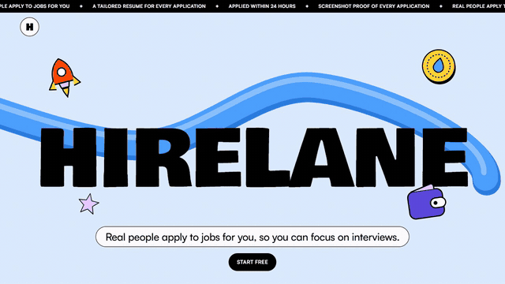
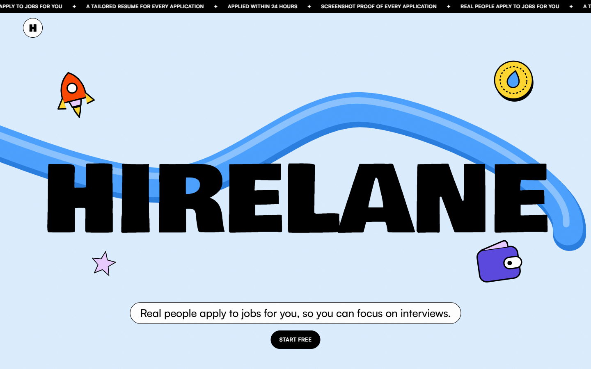
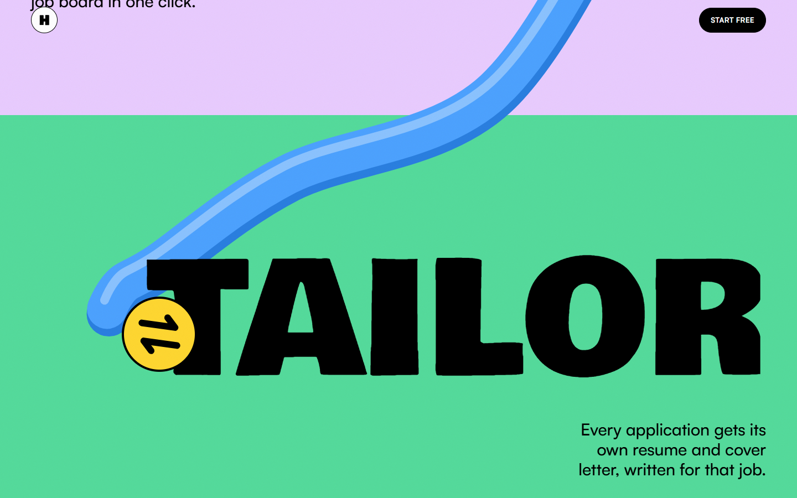
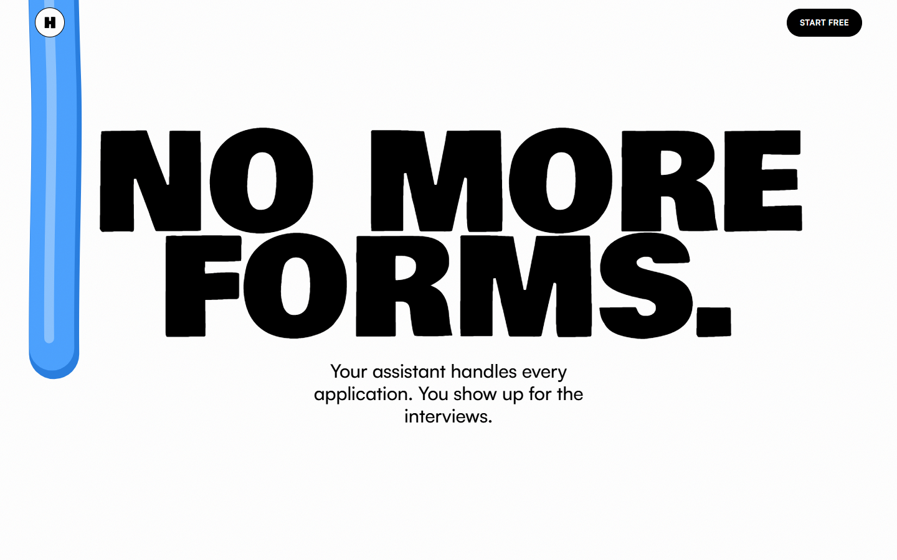
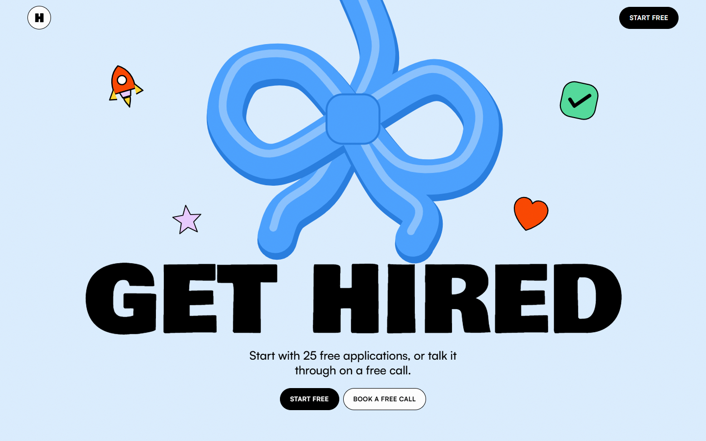
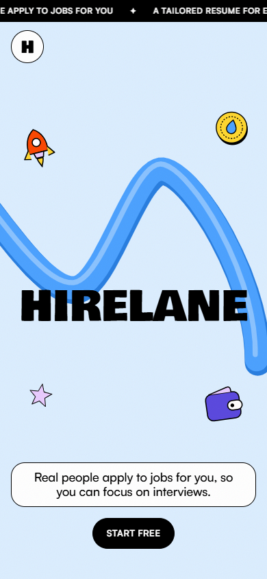
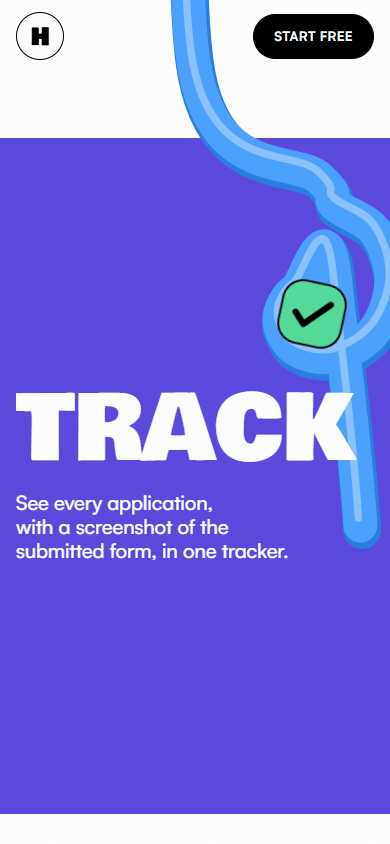
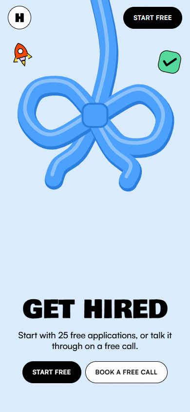

# Hirelane

A scroll-driven landing page for Hirelane, a job application service where real assistants apply to jobs for you. One continuous ribbon is drawn by your scroll through every section and ties itself into a bow at the end.



Full-quality recording: [walkthrough.mp4](docs/media/walkthrough.mp4) (1280×720, 26 s)

## Screenshots

### Desktop

| Hero | Tailor |
|---|---|
|  |  |
| **No more forms** | **Get hired** |
|  |  |

### Mobile

| Hero | Track | Get hired |
|---|---|---|
|  |  |  |

## The page, top to bottom

1. **Hero:** the Hirelane wordmark, pinned while the stickers lift off.
2. **Pick, Tailor, Apply, Track:** one verb per screen, each wiped in on its own colour band.
3. **No more forms:** twelve job-search chores fall away one by one.
4. **Nothing goes out without you:** a quiet grey section with the trust points.
5. **Get hired:** the ribbon ties itself into a bow above the calls to action.
6. **Footer:** links and a QR code for booking a call.

The page respects `prefers-reduced-motion` and works with keyboard navigation.

## Run it

```bash
npm install
npm run dev       # local dev server
npm run build     # production build in dist/
npm run preview   # serve the production build
```

## Project layout

```
src/
  App.jsx              section order and the four verb sections' copy
  components/          one file per section (Hero, Verb, Seed, Quiet, Peak, Close, ...)
  lib/                 ribbon geometry and the shared animation frame loop
  vendor/scrollcraft.* scroll engine: pinning, reveals, stagger
  styles.css           brand tokens and section styles
docs/media/            README screenshots and recording
```

Built with React 19 and Vite 7.
